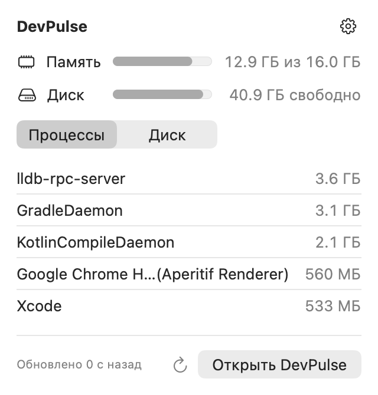
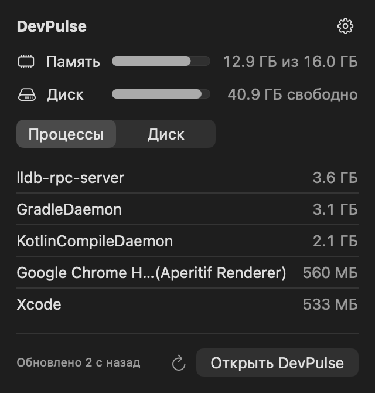
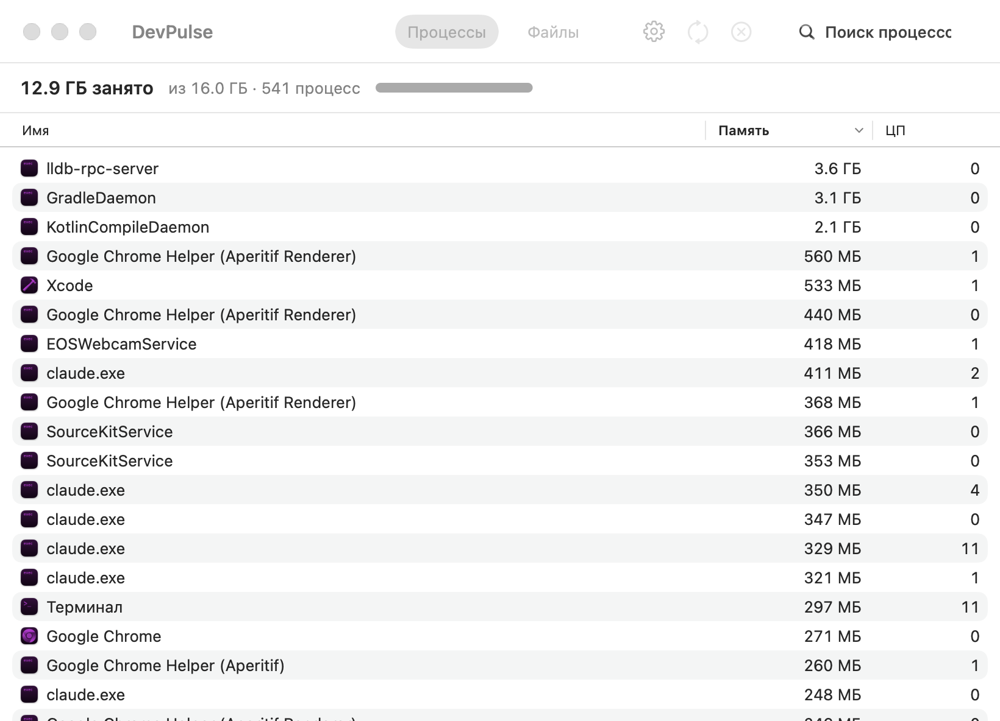

# DevPulse

A small native menu-bar utility for macOS that shows memory and disk health at a
glance and helps reclaim both: quit runaway processes, find the heaviest files and
folders in your home folder, reveal them in Finder or delete them.

Built for developer machines, where Gradle and Kotlin daemons, emulators, simulators
and DerivedData eat RAM and disk.

<p>
  
  
</p>


## Features

- **Menu bar:** `● 62% / ● 71%`, memory then disk used. The dots turn orange or red when memory
  pressure rises or free disk space runs low.
- **Popover:** memory and disk gauges, plus the top five processes or the five heaviest items
  on disk.
- **Processes:** all of your processes with memory and CPU usage, searchable and sortable.
  - Quit politely; force quit only after a process ignores the request, and only after you confirm.
  - Relaunch apps.
  - Java daemons are named by their main class (`GradleDaemon`, `KotlinCompileDaemon`) instead
    of just `java`.
- **Files:** the largest files and folders in `~`, ranked to point at the folder that actually holds the
  weight (`DerivedData`, not `~/Library`).
  - Reveal in Finder, or delete permanently after confirmation.
  - Protected roots (`~`, `~/Library`, `~/Documents`…) and anything outside home can never be deleted.
- **Native UI:** SwiftUI and AppKit with system materials (Liquid Glass on macOS 26), SF Pro, and
  light and dark appearance.
- **Launch at login**, toggled from the gear menu.

## Requirements

macOS 26 (Tahoe) or later, Apple Silicon. Building needs Xcode 26 and
[XcodeGen](https://github.com/yonaskolb/XcodeGen).

## Install

There is no notarized download yet; build and install locally:

```bash
brew install xcodegen
git clone https://github.com/peppperrroni/devpulse.git && cd devpulse
scripts/install.sh        # Release build → /Applications/DevPulse.app, then launches it
```

Run `scripts/install.sh` again to update. The script signs with your first
*Apple Development* certificate if you have one (set `DEVPULSE_SIGN_IDENTITY` to choose), so
macOS keeps the Full Disk Access grant across updates. Otherwise the app is signed ad hoc.

## Build & test

```bash
xcodegen generate
xcodebuild -project DevPulse.xcodeproj -scheme DevPulse -configuration Debug -derivedDataPath build build
swift test --package-path Packages/DevPulseCore
```

All logic lives in `Packages/DevPulseCore` (no UI, covered by tests). `DevPulseApp` is the thin
SwiftUI/AppKit layer.

## Privacy & permissions

DevPulse works entirely offline: no network access, no analytics.

- **Processes:** reads your own processes via `libproc`. It can only signal processes you own,
  and never `loginwindow`.
- **Disk:** the scan reads file sizes in your home folder and caches the result in
  `~/Library/Caches/DevPulse/scan.json`. macOS asks for access to Desktop, Documents and
  Downloads the first time. Granting **Full Disk Access** (System Settings → Privacy & Security)
  lets the scan see all of `~/Library` and stops the prompts.
- **Deletion:** files are deleted permanently and are not moved to the Trash. Nothing is ever
  deleted automatically.

## Uninstall

```bash
pkill -x DevPulse
rm -rf /Applications/DevPulse.app ~/Library/Caches/DevPulse
defaults delete com.peppperrroni.devpulse
```

Remove it from System Settings → General → Login Items if it is still listed.
